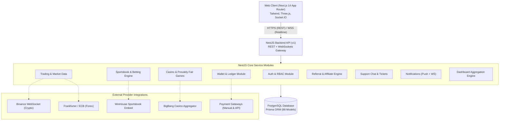

# TANVIONROYALE — Architecture Overview
**Date:** 2026-11-14

---

## 1. System Topology

---

## 2. Layered Architecture

### 2.1 Presentation Layer (`apps/web`)
- **Framework**: Next.js 14 with React Server Components (RSC) and Client Components (`use client`).
- **Styling**: Tailwind CSS with custom dark financial palette (`#06131a`, `#0b0e14`, slate, teal accents).
- **Responsive System**:
  - Desktop (`lg+`, 1024px+): Static vertical navigation sidebar (`UserSidebar`) with active-state route tracking.
  - Tablet (`md`, 768px-1023px): Collapsible interface with compact cards.
  - Mobile (`< 768px`): Header with hamburger triggering a smooth slide-out drawer, bottom tab bar (`BottomNav`) with Home, Games, Sports, Trading, and Profile.
- **State & Context**:
  - `AuthProvider`: Manages access tokens, user profile, refresh rotation, and auto-recovery.
  - `BetSlipProvider`: Manages sports betting selections, stakes, and bet slips.

### 2.2 Application Services Layer (`apps/api`)
- **Framework**: NestJS 10 running on Node 20+.
- **Routing**: Global API prefix `/api/v1` with route-level versioning and controllers.
- **Security & Guards**:
  - `JwtAuthGuard`: Enforces token validity and active user status.
  - `RolesGuard` / `PermissionsGuard`: Enforces RBAC permissions.
  - `ThrottlerGuard`: Granular per-endpoint rate limiting against brute-force attacks.
  - `AllExceptionsFilter`: Sanitizes all server errors, catches Prisma error codes (P2002, P2025, P2021), and logs safely without leaking database connection strings or internal traces.

### 2.3 Data & Persistence Layer (`database/prisma`)
- **ORM**: Prisma 5.22.0.
- **Ledger Invariant**: Double-entry ledger architecture. All balance movements record immutable `LedgerEntry` and `WalletTransaction` entries with atomic transaction rollbacks (`prisma.$transaction`).
- **Migrations**: 43 sequential SQL migrations in `database/prisma/migrations/`.

---

## 3. Preservation & Non-Destructive Principles
1. Never drop or rename columns on live PostgreSQL tables.
2. Maintain backward compatibility across all `/api/v1` endpoints.
3. Preserve existing trading chart drawing coordinate logic.
4. Keep Demo vs Real financial balances isolated.
